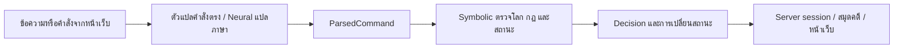

# NeSy-Escape — Nocturne Express

เกมสืบสวนภาษาไทยบนขบวนรถไฟ ผู้เล่นตรวจฉาก สอบถามพยาน เปรียบเทียบหลักฐาน และเสนอข้อสรุปก่อนกล่าวหา ใช้คดีที่มีเหตุผลหลายขั้นเพื่อศึกษาความถูกต้องของระบบดำเนินเกม และตรวจความเข้าใจเรื่องของผู้เล่นแยกจากการเก็บหลักฐานครบ

รุ่นปัจจุบันใช้คดีเบลล์เวเธอร์ปี1923 ปมสองเวลาของเหตุรุนแรงกับไฟดับ และข่าวเลื่อนนัดที่ผู้เล่นต้องตรวจต้นทาง ไม่มีปมผู้โดยสารคนที่แปด รายละเอียดพร้อมเฉลยอยู่ใน [ระยะ B](docs/phase-b-design-2026-10-12.md) และ [รายงานนำเรื่องเข้าเกม](docs/implementation-report-2026-10-12.md)

## รันเกม

ตัวอย่างสำหรับ PowerShell จากโฟลเดอร์โครงการ:

```powershell
python -m venv .venv
.venv\Scripts\python.exe -m pip install -r requirements.txt
.venv\Scripts\python.exe -m pip install -r requirements-dev.txt
Copy-Item .env.example .env
```

หากมี `.env` อยู่แล้วให้ใช้ไฟล์เดิม ใส่ `GEMINI_API_KEY` และเลือก `GEMINI_MODEL` สำหรับคำสั่งภาษาธรรมชาติ จากนั้นรัน:

```powershell
.venv\Scripts\python.exe -m uvicorn app.main:app --reload
```

เปิด [หน้าเกม](http://127.0.0.1:8000/) และ [สัญญา API](http://127.0.0.1:8000/docs) จาก server เดียวกัน คำสั่งตรง เช่น `ดูรอบๆ`, `ไปตู้ 4`, `examine pocket_watch` และหัวข้อที่กดจากหน้าเว็บมีตัวแปลคำสั่งตรง ส่วนข้อความอิสระส่งให้ Neural ตีความ

API เก็บสถานะที่ server และอ้าง session ด้วย cookie ไม่เชื่อสถานะที่ client ส่งมาเพื่อแก้ผลเกม การโหลดหน้าใหม่กลับเข้าเกมเดิม ใช้เริ่มเกมใหม่เพื่อรีเซ็ต ต้นแบบเก็บ session ในหน่วยความจำ process เดียว การรีสตาร์ต server ทำให้เกมที่เก็บอยู่หาย นาฬิกาเริ่มเมื่อเริ่มเล่น มีเวลา90นาทีและนับเวลาจริงรวมเวลาคิด อ่าน และรอระบบ

## สิ่งที่เล่นได้

- ผู้ต้องสงสัย3คน และพยาน2คนที่กล่าวหาไม่ได้
- บทสนทนาเป็นหัวข้อที่เปิดตามหลักฐาน กลับไปถามข้อมูลใหม่ได้ และไม่มอบคำให้การที่ยังไม่ได้ฟัง
- กระเป๋าสำนวนล็อกรหัส1923 ห้องแพทย์ใช้กุญแจลิโอรา ห้องระบบไฟใช้กุญแจพนักงาน การตรวจวัตถุไม่ปลดล็อกเอง
- สมุดคดีแสดงสิ่งที่พบ แหล่งคำให้การ คำถาม และข้อสรุปที่ผู้เล่นเสนอ ไม่เฉลยข้ออนุมานอัตโนมัติทั้งหมดระหว่างเล่น
- ข้อสรุปสองเวลาต้องเลือกและแนบหลักฐานเอง การเลือกข้อความถูกโดยไม่มีข้อมูลรองรับยังไม่ผ่าน
- เลือกสายชา/กระดุม/ตรา2ใน3เพื่อยื่นคดีได้จริง แต่ต้องเชื่อมเวลา แรงจูงใจ การมาพบ และต้นทางข่าวร่วมกัน
- ชุดยื่นขั้นต่ำของสามคู่เป็น19/20/20รายการ เพดาน20 อ่านเส้นทางเฉลยที่ [walkthrough](docs/walkthrough-new-story-2026-10-12.md)
- **ระบบวิเคราะห์พฤติกรรม (Player Behavior Profiler)**: จำแนกผู้เล่น 5 Archetypes (Forensic Analyst, Psychological Interrogator, Maverick Trailblazer, Intuitive Rusher, Balanced Investigator) คำนวณคะแนน 5 มิติสถิติแบบ Real-time พร้อม Dynamic Adaptation ปรับน้ำเสียง NPC และแทรกคำใบ้ช่วยเหลือเมื่อติดขัด
- **Smart Sequential Actions**: รับคำสั่งต่อเนื่องหลายคำสั่งพร้อมกันในข้อความเดียว ประมวลผลรวดเร็วใน 1 HTTP Roundtrip พร้อมกลไก Fail-early เมื่อติดกฎตรรกะ

การกล่าวหาที่เข้าเงื่อนไขฉากจบจะปิดคดีทันที รวมฉากจบที่กล่าวหาผิด หากหลักฐานไม่พอจะได้คำบอกประเด็นที่ขาดและมีจำนวนครั้งจำกัด การละหลักฐานที่อยู่ซึ่งค้นพบแล้วออกจากชุดยื่นไม่ทำให้กล่าวหาคนที่ถูกหักล้างแล้วได้

## สถาปัตยกรรมหน้าเว็บ NeSy



Neural ในหน้าเว็บแปลภาษาเป็นคำสั่ง Symbolic ตัดสินสิทธิ์ การเปิดเผยข้อมูล บท หลักฐาน ข้อสรุป และฉากจบ `reasoning_chain` ของฝั่งนี้มาจากกฎที่ตรวจจริง ไม่สร้างย้อนหลังจากโมเดลและไม่ใช้ confidence เป็นตัวผ่านกฎ

ข้อมูลเรื่องและเงื่อนไขอยู่ใน `data/story.json` กฎตรวจคำสั่งอยู่ใน `data/rules.json` การเปลี่ยนเรื่องต้องแก้เส้นทางหลักฐาน บท สมุด และฉากจบให้ตรงกันพร้อมตรวจเส้นทางทั้งสามคู่

## โครงสร้างไฟล์สำคัญ

| ไฟล์/โฟลเดอร์ | หน้าที่ |
|---|---|
|`app/main.py`, `app/sessions.py`|API เวลา session ฝั่งเซิร์ฟเวอร์ และข้อมูลผู้เล่น|
|`app/schemas.py`, `app/game_setup.py`|สัญญาคำสั่ง/สถานะ และความทรงจำบทนำ|
|`app/neural/typed_commands.py`, `app/neural/gemini_client.py`|คำสั่งตรง Zero-latency และการตีความภาษาธรรมชาติ|
|`app/symbolic/engine.py`, `app/symbolic/validation.py`|การตัดสินตรรกะ First-Order และตรวจความถูกต้องข้อมูลเกม|
|`app/profiler/` (`tracker`, `adaptation`, `telemetry`)|วิเคราะห์ 5 Archetypes, ปรับโทนตอบ NPC และส่งออกสถิติวิจัย|
|`app/case_notes.py`|หลักฐาน คำให้การ และคำถาม|
|`data/story.json`, `data/documents/`|เรื่อง วัตถุ บท ข้อสรุป ฉากจบ และเอกสาร|
|`data/walkthrough.json`, `app/walkthrough.py`|เส้นทางแกนและชุดยื่นสามทาง|
|`frontend/` (`novel.js`, `art.js`, `narrative.js`)|ฉาก แผนที่ สมุด หน้าต่างกล่าวหา ภาพประกอบ และนิยายภาพ|
|`assets/nocturne-stylized-v2/`|ไฟล์ภาพประกอบหลักฐานและฉากจบแบบ Stylized Vector Art|
|`app/neural/game_master.py`|ตัวตัดสิน neural สำหรับทดลองเปรียบเทียบ baseline|
|`scripts/evaluate_modes.py`, `data/research/`|CLI และคำตอบอ้างอิงชุดพัฒนา (adjudication corpus)|
|`tests/`|ทดสอบกฎ ข้อมูล API การสืบสวน โปรไฟล์ และ baseline (250 tests)|

## API ที่ใช้บ่อย

| วิธี | เส้นทาง | หน้าที่ |
|---|---|---|
|GET|`/health`|สถานะการตั้งค่า; `?probe=true` จึงเรียกโมเดลจริง|
|GET|`/scene`|บทนำและฉากตามสิทธิ์ session|
|POST|`/start`, `/new-game`|เริ่มเวลา และเริ่มเกมใหม่|
|POST|`/command`|รับข้อความ/หลักฐาน คืนคำสั่ง คำตัดสิน และสถานะใหม่|
|POST|`/journal`, `/hint`|สมุดและคำใบ้|
|POST|`/pillars`|ผลสี่เสาหลังคดีปิด|
|POST|`/clock`|ปรับเวลาจริงและปิดคดีเมื่อหมดเวลา|
|GET|`/reconstruction`|ฉากย้อนหลังหลังจบแท้ เล่าตามชุดหลักฐานที่ยื่น|
|GET|`/study-export`|บันทึกข้อสรุปที่เสนอ ชุดยื่น ผลจบ และเวลา|
|GET|`/profiler/profile`|ผลการวิเคราะห์พฤติกรรมผู้เล่น (Archetype, คะแนน 5 มิติ)|
|GET|`/research/telemetry`|สรุปสถิติ Session ปัจจุบัน/ย้อนหลังสำหรับงานวิจัย|
|GET|`/research/export`|ดาวน์โหลดสถิติวิจัยในรูปแบบ CSV หรือ JSON (`?format=csv` หรือ `?format=json`)|

## การทดสอบ

```powershell
.venv\Scripts\python.exe -m pytest -m "not llm" -q
node --test frontend/chat.test.mjs frontend/art.test.mjs frontend/novel.test.mjs
.venv\Scripts\python.exe scripts/evaluate_modes.py --mode symbolic --output logs/research/symbolic-smoke.json
```

การทดสอบ offline ตรวจพฤติกรรมตามกติกาและ API ไม่ใช้แทนผลโมเดลจริงหรือผู้เล่น ชุดที่เรียกบริการภายนอกต้องตรวจเงื่อนไขและการตั้งค่าของชุดนั้นก่อนรัน ดูผลตรวจส่งมอบล่าสุดใน [รายงาน](docs/implementation-report-2026-10-12.md)

ตรวจหน้าเว็บด้วย `node scripts/check_story_browser.cjs` หลังเปิดเซิร์ฟเวอร์ โดยต้องมี Playwright ติดตั้งอยู่แล้ว ตั้ง `GAME_URL` ให้ตรงกับเซิร์ฟเวอร์ (ค่าเริ่มต้น `http://127.0.0.1:8012`) และ `BROWSER_CHANNEL=msedge` เมื่อต้องการใช้ Edge ที่ติดตั้งใน Windows ผลกับภาพตรวจอยู่ใน `tmp/browser-story-check/` ชุดนี้ใช้คำสั่งตรงที่แปลในเครื่อง จึงไม่เรียกโมเดล

## การเปรียบเทียบกับ neural-only

เครื่องมือรอบนี้เทียบที่ขอบเขต **สถานะ + คำสั่งที่ตีความแล้ว → คำตัดสิน + สถานะใหม่ + ข้อมูลที่แสดง** หน้าเว็บยังเป็น NeSy โหมด `symbolic` ของ CLI ใช้ตัวตัดสินเดียวกับหน้าเว็บ ส่วน `neural` ให้โมเดลตัดสินทั้งหมดในขอบเขตนี้ โดยไม่มี symbolic ตรวจหรือซ่อมผล

```powershell
# เรียกโมเดลจริงและอาจมีค่าใช้จ่าย เลือกรุ่นที่จะทดลองอย่างชัดเจน
.venv\Scripts\python.exe scripts/evaluate_modes.py --mode neural --model YOUR_MODEL_ID --suite one-step --output logs/research/neural-one-step.json
.venv\Scripts\python.exe scripts/evaluate_modes.py --mode neural --model YOUR_MODEL_ID --suite rollout --output logs/research/neural-rollout.json

# เล่นด้วยคำสั่ง JSON ไม่ผ่าน parser หรือตัวกรอง symbolic
.venv\Scripts\python.exe scripts/evaluate_modes.py --mode neural --model YOUR_MODEL_ID --play --output logs/research/neural-play.jsonl
```

CLI แยกการเริ่มจากสถานะอ้างอิงทีละคำสั่งกับ rollout ที่ใช้สถานะจากคำตอบตัวเอง แยกความผิดของบริการ/รูปแบบจากความผิดเชิงตรรกะ และบันทึกรุ่นกับ hash คำอธิบาย neural เป็นคำกล่าวอ้างของโมเดล ไม่ใช่ trace ว่าตรวจกฎจริง

ชุด `data/research/adjudication-corpus-v1.json` ใช้ตรวจระหว่างพัฒนา จึงไม่ใช่ held-out benchmark การผ่านชุดนี้ไม่ยืนยันว่า NeSy เหนือกว่า neural-only หรือผู้เล่นเข้าใจมากกว่า ยังต้องเก็บผลโมเดลจริง ตรวจข้อความที่เปิดเผย และทดลองผู้เล่นตาม [protocol](docs/research-protocol-2026-10-12.md)

## เอกสารออกแบบ

- [ข้อเท็จจริง A2](docs/phase-a-fact-sheet-v2-2026-10-09.md)
- [สามฉากเสริม: ขึ้นรถ เผชิญหน้า และทบทวนคดี](docs/new-scenes-2026-10-13.md)
- [ความซับซ้อนและเป้าหมายการประเมิน](docs/design-goals-and-evaluation-2026-10-09.md)
- [ระยะ B และแผนผังหลักฐาน](docs/phase-b-design-2026-10-12.md)
- [วิธีตรวจเส้นทางคดี](docs/walkthrough-new-story-2026-10-12.md)
- [แผนดำเนินงานและสถานะ](docs/implementation-plan-2026-10-09.md)
- [รายงานนำเข้าเกม](docs/implementation-report-2026-10-12.md)
- [กลไกกลาง](docs/research-mechanics-v1.md) และ [protocol](docs/research-protocol-2026-10-12.md)
