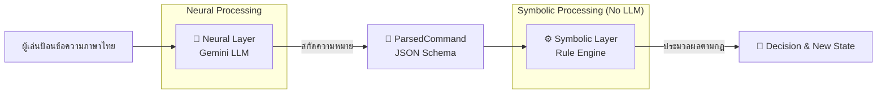

# 🕵️‍♂️ NeSy-Escape (Neuro-Symbolic Escape Room)

> **เกมสอบสวนบนขบวนรถไฟด้วยแนวคิด Neuro-Symbolic AI**  
> ผู้เล่นสั่งการด้วยภาษาไทยแบบอิสระ โดยระบบแยกส่วน **"ตีความภาษา" (Neural)** ออกจาก **"ตัดสินตามกฎ" (Symbolic)** อย่างเด็ดขาด

---

## 📌 ภาพรวมสถาปัตยกรรม (Architecture Overview)

ระบบทำงานร่วมกันแบบ 2 ขั้นตอนเพื่อความถูกต้อง แม่นยำ และอธิบายเหตุผลได้ (Explainability):



1. **Neural Layer (Gemini LLM)**: ทำหน้าที่แปลงข้อความภาษาไทยธรรมชาติของผู้เล่นให้เป็น `ParsedCommand` ตาม Schema ที่กำหนด (เช่น Intent, Target Object, Arguments)
2. **Symbolic Layer (Rule Engine)**: นำ `ParsedCommand` มาตรวจสอบกับคลังกฎ (`data/rules.json`) และสถานะเกม (`GameState`) เพื่อตัดสินผลลัพธ์ (`Decision`) โดย**ไม่พึ่งพา LLM**

---

## ⚠️ หลักการสำคัญที่ห้ามละเมิด (Core Invariants)

> [!IMPORTANT]
> 1. **Rule Engine ห้ามเรียก LLM เด็ดขาด**: `app/symbolic/engine.py` ต้องทำงานแบบ Deterministic 100%
> 2. **Reasoning Chain ต้องโปร่งใส**: สายธารเหตุผล (`reasoning_chain`) ต้องเกิดจากการตรวจกฎจริง ห้ามให้ LLM เขียนย้อนหลังหรือสร้างเหตุผลปลอม
> 3. **ห้ามใช้ Confidence ตัดสินใจ**: ค่าความมั่นใจจาก LLM ใช้เพื่อ Logging/Tracking เท่านั้น ห้ามนำมาบิดเบือนกฎใน Symbolic Layer
> 4. **แยกภาษาไทยและภาษาอังกฤษชัดเจน**: 
>    * **ID & รหัสกฎ** (เช่น `service_pantry`, `R005_...`) ใช้ภาษาอังกฤษเป็นสัญญากลางระหว่างสองเลเยอร์
>    * **ข้อความโต้ตอบผู้เล่น** ใช้ภาษาไทยทั้งหมด

---

## 📁 โครงสร้างโปรเจกต์ (Project Structure)

```text
 Senior Project/
 ├── app/
 │   ├── main.py              # FastAPI Web Endpoints (/health, /scene, /command)
 │   ├── schemas.py           # Data Schemas สัญญากลางระหว่าง Neural & Symbolic
 │   ├── scenario.py          # โหลดและจัดการข้อมูล Game World
 │   ├── invariants.py        # ระบบตรวจสอบความถูกต้องของกฎและสถานะ
 │   ├── walkthrough.py       # เส้นทางเฉลยสำหรับใช้รัน Integration Test
 │   ├── neural/              # เลเยอร์ตีความภาษา (Gemini Integration)
 │   └── symbolic/            # เลเยอร์ตัดสินตามกฎ (Rule Engine & Checkers)
 ├── data/
 │   ├── story.json           # ข้อมูลฉาก สิ่งของ และข้อความในเกม
 │   ├── rules.json           # คลังกฎทั้งหมดของเกม (แก้กฎที่นี่)
 │   └── walkthrough.json     # ลำดับคำสั่งเฉลย 14 ตา
 ├── frontend/
 │   ├── index.html           # หน้าจอเกมแบบ Web Chat
 │   ├── style.css            # ตกแต่ง UI
 │   └── chat.js              # จัดการ GameState และสื่อสารกับ API
 ├── scripts/                 # สคริปต์ Helper และ Tooling
 │   ├── start_app.py         # สคริปต์เปิด Web Server พร้อมเปิดเบราว์เซอร์อัตโนมัติ
 │   └── run_app.bat          # Batch script สำหรับสั่งรันเซิร์ฟเวอร์บน Windows
 ├── docs/                    # เอกสารระบบและไฟล์สรุปเชิงทฤษฎี
 ├── tests/                   # ชุดทดสอบด้วย pytest
 └── play.py                  # สคริปต์รันเล่นผ่าน CLI
```

---

## 🚀 การติดตั้งและการใช้งาน (Getting Started)

### 1. การเตรียมสภาพแวดล้อม (Environment Setup)

สร้างและเปิดใช้งาน Virtual Environment แล้วลง Dependencies:

```bash
# ติดตั้ง Packages หลัก
pip install -r requirements.txt

# (ตัวเลือก) ติดตั้ง Packages สำหรับ Dev/Test
pip install -r requirements-dev.txt
```

### 2. ตั้งค่า API Key

คัดลอกไฟล์ `.env.example` เป็น `.env` แล้วใส่ `GEMINI_API_KEY`:

```bash
cp .env.example .env
```
แก้ไขไฟล์ `.env`:
```env
GEMINI_API_KEY=your_gemini_api_key_here
```

### 3. รัน Web Server & Frontend

เริ่มรัน API Server ได้ด้วยวิธีใดวิธีหนึ่ง:

```bash
# วิธีที่ 1: รันด้วย Uvicorn โดยตรง
uvicorn app.main:app --reload

# วิธีที่ 2: รันผ่าน Helper Script (เปิด Browser ให้อัตโนมัติ)
python scripts/start_app.py

# หรือดับเบิลคลิก scripts/run_app.bat (สำหรับ Windows)
```

* **API Documentation (Swagger UI)**: [http://127.0.0.1:8000/docs](http://127.0.0.1:8000/docs)
* **Frontend**: เปิดไฟล์ `frontend/index.html` บน Browser หรือรันผ่าน Live Server

---

## 🔌 API Endpoints Summary

> [!NOTE]
> เซิร์ฟเวอร์ได้รับการออกแบบให้เป็น **Stateless Server** โดยฝั่ง Client (`chat.js`) จะเป็นผู้ถือ `GameState` แล้วส่งกลับมาพร้อมกับคำสั่งในทุก Request

| Method | Endpoint | Description | Payload / Response |
| :--- | :--- | :--- | :--- |
| `GET` | `/health` | ตรวจสอบสถานะของเซิร์ฟเวอร์ | `{ "status": "ok" }` |
| `GET` | `/scene` | ดึงข้อมูล Registry ID, Briefing และ `initial_state` | ข้อมูล Game World ทั้งหมด |
| `POST` | `/command` | ส่งคำสั่งภาษาไทยเพื่อประมวลผล | Request: `{ text, state }`<br/>Response: `{ parsed, decision, new_state }` |

---

## 🧪 การทดสอบและการรันการทดลอง (Testing & Experiments)

เวลาในเกมนับตามเวลาเล่นจริงตั้งแต่โหลดคดี รวมเวลาอ่าน คิด และรอคำตอบ ไม่หักเวลาตามจำนวนคำสั่ง หน้าเว็บนับถอยหลังทุกวินาทีและเรียก `POST /clock` เพื่อปิดคดีเมื่อหมดเวลาโดยไม่ต้องพิมพ์เพิ่ม เวลาเริ่มต้นอยู่ใน `GameState.started_at` และฝั่ง API คำนวณเวลาที่ผ่านไปก่อนตรวจกฎ การรีเฟรชหน้าเว็บเริ่มคดีใหม่ตามเดิม

การกล่าวหาต้องมีหลักฐานและข้อสรุปเข้าเงื่อนไขฉากจบที่ระบุผู้ต้องสงสัยคนนั้นก่อน กฎ R012 ตรวจเงื่อนไขจากข้อมูลฉากจบโดยตรง หากไม่ครบจะปฏิเสธและเล่นต่อได้ ส่วนกฎสี่เสาใช้จำแนกความสมบูรณ์ของคดี การกล่าวหา Vincent ต้องพบสายทองแดงที่ถูกตัด (`cut_copper_wire`), คีมตัดสายไฟ (`wire_cutters`) และรอยเลือด (`vincent_blood`) ครบทั้งสาม และยังไม่หักล้างเส้นเวลาตามเงื่อนไขฉากจบเดิม

สำหรับ Liora ต้องพบเอกสารเชื่อมโยงกับ Project Nocturne (`secret_file`) และท่าทีลังเลเรื่องเวลาตาย (`liora_time_hesitation` จากการสอบปากคำ) พร้อมกับยังไม่พิสูจน์ว่า Vincent ตัดไฟ (`D13_VINCENT_CUT_THE_POWER`) และยังไม่มีคำรับสารภาพ (`vincent_blackout_confession`) สำหรับ Gideon ต้องเชื่อมโยงแฟ้ม C ได้ก่อน (`C01_DOCUMENT_LINK`) จึงกล่าวหาได้: ถ้ามีเท่านี้หรือเงื่อนไขยังไม่ครบจะได้ Ending C (`cold_justice`) ส่วน True Ending ต้องพิสูจน์เวลาตาย 20:20–20:25 น., ไม่มีพยานช่วง 20:00–20:40 น. และเชื่อมโยงเขม่าสีแดง แหวน และกระดุมครบทั้งสามทาง ไม่ต้องล้างข้อสงสัยอีกสองคนก่อน โดยเลือก True Ending ก่อน Ending C เสมอเมื่อครบเงื่อนไข

### รัน Automated Unit Tests
```bash
python -m pytest -v
```
*(หมายเหตุ: ชุดทดสอบที่ต้องใช้ LLM จะ Skip ให้อัตโนมัติหากไม่มี API Key)*

### เล่นผ่าน CLI
```bash
python play.py
```

---

## 🛠️ วิธีการเพิ่มกฎใหม่ในเกม (Adding New Rules)

1. แก้ไขและเพิ่มกฎใน `data/rules.json` (กำหนด Rule ID เช่น `R006_...`)
2. เขียนฟังก์ชัน Checker ใหม่ใน `app/symbolic/engine.py`
3. ลงทะเบียน Checker ใหม่ในดิคชันนารี `CHECKERS` ของ `engine.py`
4. รัน `python -m pytest` เพื่อยืนยันว่ากฎใหม่ไม่ทำให้เกมเดินไม่จบ
