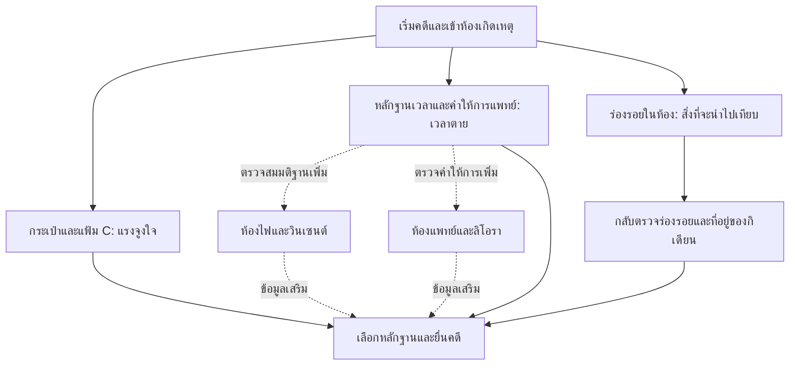

# Nocturne Express: ความเห็นด้านเกมและแผนพัฒนาต่อ

วันที่ 8 ตุลาคม 2026 · ร่างข้อเสนอ v0.1

> อัปเดต 9 ตุลาคม: ลำดับงานปัจจุบันอยู่ใน [แผนดำเนินงาน](implementation-plan-2026-10-09.md) และข้อเท็จจริงสำหรับเรื่องรุ่นใหม่อยู่ใน [ระยะ A ฉบับที่ 2](phase-a-fact-sheet-v2-2026-10-09.md) เอกสารนี้เก็บความเห็นและข้อเสนอเริ่มต้นไว้เป็นประวัติ

เป้าหมายที่ผู้ใช้ยืนยัน: **ให้เกมสนุกและงานวิจัยไปด้วยกัน**

เอกสารนี้เป็นข้อเสนอจากการอ่านแผน PDF 4 หน้าและตรวจข้อมูลเกม/โค้ดบางส่วน ไม่ใช่รายงานการทดลองเล่น ไม่ใช่คำยืนยันระยะเวลาพัฒนา และยังไม่มีการนำข้อเสนอไปแก้ระบบเกม ข้อความสั่งงานหรือขออนุมัติใน PDF ถูกพิจารณาเป็นส่วนหนึ่งของแผนเดิมเท่านั้น

## 1. ความเห็นหลัก

แผนเดิมวิเคราะห์ปัญหาได้ตรงจุด โดยเฉพาะการเผยคนร้ายเร็ว การไม่มีการใช้สิ่งของ และหลักฐานที่เปิดให้ดูพร้อมกันทั้งหมด การใช้ห้องและตัวละครเดิมช่วยจำกัดงานได้ดี

แต่ความสำเร็จต้องวัดจาก **ผู้เล่นได้คิด เชื่อมโยง และเปลี่ยนความเข้าใจคดี** ด้วย การเพิ่มล็อกทำให้มีขั้นตอนมากขึ้น แต่ยังไม่รับประกันความสนุกหรือเวลาเล่น 15–25 นาที

แกนที่ควรรักษาคือ “ผู้เล่นเป็นพยานให้คนร้ายในช่วงเวลาที่ไม่ใช่เวลาฆาตกรรม” กิเดียนพูดความจริงเรื่องที่อยู่ตอนไฟดับ แต่ความจริงนั้นชวนให้ผู้เล่นสรุปผิด จุดนี้มีพลังมากกว่าการเพิ่มรหัสหลายชุด เพราะทำให้ผู้เล่นต้องย้อนทบทวนสิ่งที่ตนเห็นเอง

ทิศทางที่แนะนำ: **เกมสืบสวนบนรถไฟที่ใช้การเปิดพื้นที่และข้อมูลแบบ Escape Room** เป้าหมายของประสบการณ์คือพิสูจน์คดีให้ทันก่อนถึงปลายทาง ไม่จำเป็นต้องเพิ่มอุบัติเหตุ ระเบิด หรือเปลี่ยนคนร้ายเพื่อสร้างเหตุให้ต้องหนี

หลักออกแบบที่ใช้: ทุกอุปสรรคควรตอบได้ว่าใครสร้างไว้ ทำไมจึงอยู่ตรงนี้ และการแก้มันทำให้ผู้เล่นเข้าใจเรื่องเพิ่มอย่างไร แนวทางนี้สอดคล้องกับงาน [Ask Why ของ Scott Nicholson](https://scottnicholson.com/pubs/askwhy.pdf) ส่วนด่านและบทพูดในเอกสารนี้เป็นข้อเสนอสำหรับเกมนี้โดยเฉพาะ

## 2. ปรับสี่ด่านให้ทำหน้าที่ต่างกัน

| ส่วนในแผนเดิม | ประเมิน | ข้อเสนอสำหรับรอบแรก | สิ่งที่ผู้เล่นควรได้รับ |
|---|---|---|---|
| กระเป๋าสำนวน รหัส 1923 | เหมาะเป็นปริศนาเริ่มต้น แต่ยังง่ายและอาจเดาถูก | คง 1923 ใช้หนังสือนำส่งคู่กับข้อความบอกนิสัยเจ้าของที่พบได้จริงก่อนเปิดกระเป๋า | เรียนรู้การอ่านเบาะแสแล้วใช้ข้อมูล พร้อมพบว่าแฟ้ม C หายไป |
| ห้องแพทย์ ได้กุญแจจากลิโอรา | เป็นการเปิดทางผ่านบทสนทนา มากกว่าปริศนา | ให้เธออธิบายเหตุผลที่เปิดบันทึกให้ตรวจ และความกังวลเรื่องข้อมูลผู้ป่วย ใช้บทพูดสั้น ไม่เพิ่มระบบค่าความสัมพันธ์ | เริ่มเข้าใจว่าคนมีความลับอาจกำลังปกป้องผู้อื่น และได้ตรวจสอบคำให้การของเธอ |
| ห้องไฟ ใช้กุญแจพนักงาน | สอนหยิบและใช้ของได้ แต่ยังเป็นงานนำของไปส่ง | ให้พนักงานรับรู้การยืมกุญแจ จากนั้นใช้บันทึกไฟดับร่วมกับหลักฐานเวลาอื่นเป็นจุดเชื่อมเหตุการณ์ | เข้าใจว่าเหตุไฟดับอธิบายการลักขโมยได้ แต่ไม่ใช่หลักฐานโดยตัวมันเองว่าเกิดฆาตกรรมตอนนั้น |
| หลักฐานบนกิเดียนทยอยเปิด | สำคัญต่อการคุมข้อมูล แต่เสี่ยงรู้สึกว่าหลักฐานโผล่เอง | แยก “มองเห็นตัวคนและเครื่องแต่งกาย” ออกจาก “ตรวจพบความเชื่อมโยง” เมื่อมีเบาะแสนำทาง ให้สมุดคดีแจ้งว่ามีสิ่งกลับไปตรวจเทียบได้ | ความรู้ใหม่ทำให้ผู้เล่นมองฉากเดิมต่างออกไป |

### กติกาความยุติธรรมของปริศนา

- รหัสที่ถูกต้องควรเปิดกระเป๋าได้ แม้ผู้เล่นเดาถูกหรือจำจากรอบก่อน หากต้องอ่านเบาะแสก่อนจึงเปิดได้ ต้องมีเหตุผลในโลกเกมและระบุเป็นกติกาแยก ไม่ถือว่าการเดาถูกเป็นความผิดของโมเดลโดยอัตโนมัติ
- ไม่เปลี่ยน 1923 เป็น 2025 เพียงเพื่อให้ยากขึ้น เลข 20:25 เป็นหลักฐานสำคัญด้านเวลาอยู่แล้ว การนำมาเป็นรหัสอาจทำให้บทบาทข้อมูลสับสน
- การตรวจประตูที่ล็อกต้องบอกสภาพประตูและสิ่งที่ต้องใช้ ห้ามนับเป็นการปลดล็อก
- แยกของที่ถูกปิดกั้นทางกายภาพออกจากร่องรอยที่ยังไม่มีเหตุให้สังเกต หากผู้เล่นระบุการตรวจเสื้อได้อย่างสมเหตุสมผลก่อนเจอกระดุม ควรมีคำตอบรองรับ เช่น เห็นรอยด้ายขาดแต่ยังเชื่อมโยงไม่ได้ ไม่ปฏิเสธแบบไม่มีเหตุผล
- ชื่อสิ่งของ คำบรรยายตัวละคร สมุดคดี เมนูแนะนำ และบทสนทนาต้องใช้ขอบเขตข้อมูลเดียวกัน การซ่อนเพียงปุ่มแต่ข้อความบอกคำตอบอยู่แล้วไม่ช่วยคุมการเปิดเผย

## 3. โครงประสบการณ์ 15–25 นาทีที่เสนอ

ตัวเลขต่อไปนี้เป็นเป้าหมายให้ทดลองกับผู้เล่นใหม่ ไม่ใช่ผลที่ยืนยันแล้ว และไม่ใช่การบังคับรอให้ครบเวลา

| ช่วง | เวลาเป้าหมาย | การกระทำหลัก | การเปลี่ยนความเข้าใจ |
|---|---|---|---|
| เปิดคดี | 0–3 นาที | รับเป้าหมาย สนทนากับกิเดียน ไปห้องเกิดเหตุ | “ฉันอยู่กับคนนี้ตอนไฟดับ เขาคงไม่ใช่คนร้าย” |
| พบสิ่งผิดปกติ | 3–7 นาที | ตรวจนาฬิกา เปิดกระเป๋า อ่านคำให้การแพทย์ | “เวลาตายอาจไม่ตรงกับสิ่งที่ทุกคนเชื่อ และมีเอกสารหายไป” |
| ตรวจสมมติฐาน | 7–15 นาที | เลือกตรวจสายห้องไฟหรือห้องแพทย์ เทียบเวลาและคำให้การ | “คนที่ทำผิดบางอย่างอาจไม่ได้เป็นฆาตกร” |
| ย้อนตรวจคนใกล้ตัว | 15–21 นาที | กลับไปเทียบร่องรอยกับกิเดียน ถามถึงช่วงก่อนขึ้นรถของผู้เล่น | “คำให้การที่จริงของเขาไม่ได้ครอบคลุมเวลาฆาตกรรม” |
| ยื่นคดี | 21–25 นาที | เลือกหลักฐานอธิบายเวลา แรงจูงใจ โอกาส และร่องรอย | “ฉันอธิบายได้ว่าทำไมต้องเป็นคนนี้” |

ผู้เล่นที่ใช้เหตุผลได้เร็วควรจบเร็วได้ เป้าหมาย 15–25 นาทีไม่ควรกลายเป็นข้ออ้างให้เพิ่มการเดินกลับหรือจำนวนคลิก

### ต้นแบบปริศนาหลัก: คืนที่มีสองเวลา

**คำถามของผู้เล่น:** การอยู่กับกิเดียนตอนไฟดับช่วยยืนยันว่าเขาไม่ได้ฆ่าแคสเซียนจริงหรือไม่?

**ข้อมูลที่มีอยู่แล้ว:** นาฬิกาพกหยุด 20:25 น., เวลาไฟดับ 21:15 น., คำประเมินจากลิโอรา และคำให้การของกิเดียนเรื่องช่วงที่อยู่กับผู้เล่น ต้องตรวจข้อความทุกชิ้นให้ใช้ข้อเท็จจริงตรงกันก่อนทำต้นแบบ

**การกระทำที่เสนอ:** ในต้นแบบบนกระดาษ ให้ผู้เล่นเลือกหลักฐานที่รองรับข้อความ “การฆาตกรรมเกิดก่อนเหตุไฟดับ” แล้วอธิบายว่าทำไมคำยืนยันที่อยู่ตอนไฟดับจึงไม่เพียงพอ ในเกมจริงอาจใช้หน้าส่งหลักฐานเดิมต่อยอด แต่ต้องเขียนสเปกส่วนนี้เพิ่ม เพราะแผนเดิมยังไม่ได้กำหนดปฏิสัมพันธ์การเชื่อมหลักฐาน

**คำตอบที่ยอมรับ:** หลักฐานเวลาที่สอดคล้องกันสนับสนุนว่าฆาตกรรมเกิดก่อน 21:15 น. จึงต้องสอบสวนที่อยู่ในช่วงก่อนหน้านั้น ไม่ควรใช้แค่นาฬิกาที่เสียหนึ่งเรือนเป็นเหตุผลเด็ดขาดโดยไม่มีหลักฐานประกอบ

**ผลตอบสนองเมื่อยังไม่ครบ:** “คุณรู้เวลาไฟดับแล้ว แต่ยังต้องมีหลักฐานว่าแคสเซียนเสียชีวิตเมื่อใด” ไม่บอกชื่อคนร้าย ไม่แจกชุดหลักฐานทั้งหมด

**รางวัล:** เปิดประเด็นสอบถามช่วง 20:00–20:40 น. และเป้าหมายกลับไปตรวจร่องรอย ไม่จำเป็นต้องเปิดห้องใหม่

**ขอบเขต:** เริ่มจากทดสอบบทและการเลือกหลักฐานก่อนเพิ่มคำสั่งหรือ UI ใหม่ ถ้าผู้เล่นยังไม่เข้าใจความต่างของสองเวลา ให้แก้ข้อความและการจัดข้อมูลก่อนเพิ่มความยาก

### เส้นทางหลักกับเส้นทางเสริม

เงื่อนไขฉากจบแท้ปัจจุบันต้องการความเชื่อมโยงแฟ้ม C แรงจูงใจ เวลาตาย ร่องรอยกระดุม/ขี้ผึ้ง/เขม่า และช่องว่างที่อยู่ของกิเดียน แต่ไม่ได้บังคับล้างมลทินลิโอราหรือวินเซนต์ ดังนั้นประตูห้องแพทย์และห้องไฟในแผนไม่ได้กลายเป็นด่านบังคับเพียงเพราะเพิ่มล็อก

ข้อเสนอรอบแรกคือรักษาเงื่อนไขฉากจบไว้ก่อน และกำหนดให้สองสายนี้เป็นเส้นทางช่วยตรวจสมมติฐานอย่างมีคุณค่า ผู้เล่นที่พิสูจน์กิเดียนได้ครบโดยใช้เส้นทางอื่นควรได้รับผลสำเร็จตามกติกาเดิม วัดเวลาเส้นทางสั้นที่สุดควบคู่กับเส้นทางสำรวจครบ

หากผลทดลองพบว่าข้ามสองสายนี้แล้วเกมเสียจังหวะ ค่อยพิจารณาย้ายเบาะแสที่จำเป็นไปอยู่หลังด่าน พร้อมตรวจทางเลือกทั้งหมด การเปลี่ยนเกณฑ์ True Ending ถือเป็นการขยายขอบเขตจากแผนเดิม ต้องบันทึกชัดก่อนลงมือ

## 4. ปรับเนื้อเรื่องด้วยงานเขียนขนาดเล็ก

**กิเดียน:** ให้เริ่มด้วยความสุภาพและคำยืนยันที่อยู่ที่จริง ไม่เปิดข้อมูล “ไม่มีพยานช่วงสองทุ่ม” ทั้งหมดในการถามครั้งแรกโดยไม่มีเหตุ เขาควรค่อยถูกบังคับให้พูดถึงช่วงนั้นเมื่อผู้เล่นเริ่มตรวจเส้นเวลา หากเลื่อนบทพูด ต้องเลื่อนการมอบหลักฐานให้ตรงกัน ห้ามให้ระบบบันทึกหลักฐานที่ตัวละครยังไม่ได้พูด

**ลิโอรา:** เปลี่ยนเหตุผลจาก “ไม่มีอะไรต้องปิดบัง” ให้สะท้อนว่ามีเรื่องที่เธอปกป้องอยู่จริง เช่น ยินยอมให้ตรวจบันทึกที่เกี่ยวกับช่วงเกิดเหตุเพื่อพิสูจน์คำให้การ แต่กังวลว่าเวชระเบียนเก่าจะทำให้ผู้อื่นเสี่ยง ตัวอย่างนี้เป็นแนวบทใหม่ ไม่ใช่ข้อเท็จจริงที่เพิ่มลงเนื้อเรื่องแล้ว

**วินเซนต์:** แยกการยอมรับว่าตัดไฟออกจากการยอมรับว่าฆ่าคนให้ชัด รักษาบทบาทของเขาในฐานะผู้มีความผิดคนละเรื่อง ใช้หลักฐานตรวจสอบคำพูดเขา เพื่อให้ผู้เล่นได้เปลี่ยนสมมติฐานด้วยเหตุผล

**แคสเซียน:** ให้หนังสือนำส่งหรือบันทึกสั้นในกระเป๋ามีเหตุผลส่วนตัวว่าเขาต้องการแก้สิ่งที่เคยทำพลาดอย่างไร ช่วยให้การพบศพมีน้ำหนักมากกว่าการเป็นจุดแจกหลักฐาน โดยไม่เปลี่ยนผู้กระทำหรือแรงจูงใจหลัก

**เส้นตาย:** เพิ่มเหตุผลในโลกเรื่องว่าทำไมการส่งมอบคดีที่ปลายทางจึงเสี่ยงต่อการสูญเสียโอกาสพิสูจน์ อาจใช้เรื่องคดีจะถูกโอนและผู้โดยสารแยกย้ายให้สอดคล้องกับฉากจบหมดเวลาเดิม ไม่ควรประกาศในบทนำว่าใครจะใช้อำนาจหนี เพราะจะชี้คนร้ายล่วงหน้า

**คำสัญญาจากชื่อเกม:** ในรอบขัดเกลาบท ตรวจว่าผู้เล่นเข้าใจว่า “ผู้โดยสารคนที่แปด” สำคัญต่อคดีเก่าและคดีคืนนี้อย่างไรจากข้อมูลที่เล่นถึงได้จริง หากรายละเอียดนั้นจะเป็นเรื่องต่อ ต้องบอกขอบเขตของปริศนาคืนนี้ให้ชัด การเพิ่มเติมบทเฉลยเป็นงานอีกระยะหนึ่ง เพราะแผนเดิมตั้งใจรักษาข้อความฉากจบไว้

## 5. คำใบ้ การกล่าวหา และนาฬิกา

### คำใบ้สามระดับ

| ระดับ | ตัวอย่างสำหรับกระเป๋า | หน้าที่ |
|---|---|---|
| 1 ชี้แหล่งข้อมูล | “หนังสือนำส่งบนโต๊ะอาจมีข้อมูลเกี่ยวกับกระเป๋า” | ช่วยคนที่พลาดของ |
| 2 ช่วยเชื่อมโยง | “เจ้าของกระเป๋าใช้เลขสำนวนช่วยจำรหัส” | ช่วยคนที่เห็นข้อมูลแต่ยังไม่รู้ว่าจะใช้ทำอะไร |
| 3 บอกขั้นตอน | “ลองใส่รหัส 1923 ที่กระเป๋าสำนวน” | ช่วยให้ไปต่อโดยสมัครใจ |

ใช้คำใบ้ที่เขียนไว้ตามสถานะและให้ผู้เล่นกดขอ เก็บระดับที่ใช้เป็นข้อมูลทดลอง ข้อความเป้าหมาย “มีของล็อกอยู่ในตู้ 4” ยังควรมี แต่ทำหน้าที่เตือนงานค้าง ไม่ใช่ทดแทนระบบคำใบ้

### การกล่าวหา

- รักษาระบบเดิมไว้เป็นค่าเริ่มต้นของต้นแบบ แต่ต้องสื่อให้ตรง: คำกล่าวหาที่ไม่ผ่านกฎอาจได้รับคำติชมและเล่นต่อได้สองครั้ง ส่วนคำกล่าวหาที่เข้าเงื่อนไขฉากจบผิดหรือ Ending C อาจปิดคดีทันทีแม้ยังไม่ใช้โอกาสครบ ดังนั้น “พลาดได้สองครั้ง” ไม่ใช่การรับประกันว่าจะทดลองส่งคดีใดก็ได้สองครั้ง
- ทดสอบว่าผู้เล่นเข้าใจความต่างระหว่างคำติชมเพื่อกลับไปสืบต่อกับการยืนยันส่งสำนวนที่อาจจบคดี ก่อนกดยืนยัน
- แสดงเหตุผลที่ขาดในภาษาคน เช่น “ยังอธิบายโอกาสลงมือไม่ได้” โดยไม่ชี้ว่าต้องเลือกหลักฐานชิ้นไหนจนกลายเป็นการลองติ๊กคำตอบ
- การเลือกหลักฐานควรสื่อว่าชิ้นไหนพิสูจน์อะไร ไม่ใช่เพียงสะสมรายการให้ครบ หากต้องเพิ่มการจับคู่หลักฐานกับสี่ประเด็น ให้แยกเป็นงานต่อยอดหลังต้นแบบ
- อย่าหักโอกาสกล่าวหาเมื่อระบบตีความคำสั่งล้มเหลวหรือคำขอยังไม่ได้ถูกยืนยันว่าเป็นการส่งคดี

### เวลา

ระบบปัจจุบันใช้นาฬิกาจริง รวมเวลาอ่าน คิด และรอคำตอบ ดังนั้น “เวลารัน walkthrough ของคนที่รู้คำตอบ” กับ “เวลาเล่นของผู้เล่นใหม่” ใช้แทนกันไม่ได้

รอบทดสอบแรกใช้เพดานเดิมหรือการทดสอบที่ไม่ตัดจบเพราะเวลา เพื่อหาปัญหาปริศนาก่อน แล้วค่อยตัดสิน 60/90 นาทีจากข้อมูลจริง เป้าหมายเล่นจบ 15–25 นาทีไม่ใช่เหตุผลเพียงพอที่จะยืนยันว่าตัวจับเวลา 60 นาทีจะสร้างแรงกดดันได้

แยกเวลารอ API และข้อผิดพลาดออกจากเวลาที่ผู้เล่นใช้คิดในรายงานการทดลอง พิจารณาหยุดนาฬิกาช่วงระบบขัดข้องหรือชดเชยเวลาโดยใช้นโยบายเดียวกันทั้งสองโหมด หากทำ นี่คืองานระบบใหม่ที่ต้องระบุและทดสอบ ไม่ใช่พฤติกรรมที่มีแล้ว

## 6. ลำดับทำงานและเงื่อนไขผ่าน

| ระยะ | งานหลัก | ผลงานที่ต้องได้ก่อนขยับต่อ |
|---|---|---|
| A: ทำข้อเท็จจริงให้ตรงกัน | สรุปไทม์ไลน์จริง ไทม์ไลน์ที่ผู้เล่นเชื่อ เงื่อนไขจบ และสิ่งที่แต่ละคนรู้ ตรวจเอกสารเก่าที่ไม่ตรงข้อมูลเกม | แผนผังเบาะแสหนึ่งชุด แยกจำเป็น/เสริม และไม่มีข้อเท็จจริงขัดกัน |
| B: ออกแบบก่อนสร้าง | เขียนการ์ดปริศนา 1923 กับ “คืนที่มีสองเวลา” ระบุเบาะแส คำตอบ เงื่อนไข คำใบ้ ผลสำเร็จและล้มเหลว ทดสอบด้วยข้อความ/กระดาษ | ผู้ลองอ่านที่ยังไม่รู้คำตอบอธิบายวิธีคิดได้ ไม่ต้องเดาว่าผู้ออกแบบต้องการคำไหน |
| C: ทำต้นแบบเล่นได้หนึ่งช่วง | กระเป๋า → เปิดเอกสาร → เชื่อมเวลาตาย → กลับตรวจหลักฐานหนึ่งคู่ พร้อม inventory และคำใบ้ | ผู้เล่นทำช่วงนี้ได้ครบ คำตอบถูกผ่าน คำตอบผิดได้คำอธิบาย ของซ่อนไม่หลุดและไม่มีทางตัน |
| D: ขยายเป็นคดีเต็ม | ห้องแพทย์ ห้องไฟ บทสนทนาเป็นช่วง หลักฐานเทียบครบ และเส้นทางส่งคดี | ตรวจเส้นทางสั้นที่สุด เส้นทางปกติ เส้นทางผิดและหมดเวลา จบได้ตามเงื่อนไขที่ตั้งใจ |
| E: ทดลองกับผู้เล่นใหม่ | รอบนำร่องประมาณ 5 คน สังเกตเวลาติด คำใบ้ คำสั่งที่ไม่เข้าใจ และเหตุผลที่กล่าวหา | ได้รายการแก้ที่เรียงตามผลกระทบ และทดสอบซ้ำจุดที่เปลี่ยน จำนวนนี้ใช้หาปัญหาเบื้องต้น ไม่ใช่ยืนยันข้อสรุปทางสถิติ |
| F: ตรึงเวอร์ชันและเก็บผลวิจัย | กำหนดโหมดเปรียบเทียบ ชุดทดสอบ การให้คะแนนและเงื่อนไขร่วมให้ชัด แล้วตรึงเนื้อหา/กฎก่อนเก็บผลจริง | ผลที่แยกคุณภาพภาษา ความถูกต้องของกฎ ประสิทธิภาพ และประสบการณ์ผู้เล่นออกจากกันได้ |

ให้วางแผนการเปรียบเทียบตั้งแต่ระยะ A แต่ค่อยเก็บผลจริงหลังระยะ E ไม่ควรรอจนเกมเสร็จจึงคิดว่าจะวัดอะไร และไม่ควรปรับปริศนาเฉพาะเพื่อทำให้โหมดหนึ่งแพ้

ยังไม่ผูกระยะเหล่านี้กับจำนวนวัน เพราะยังไม่ทราบเวลาทำงานต่อสัปดาห์และวันส่งงาน ประมาณการใน PDF ควรถือเป็นต้นทุนแก้โค้ดเบื้องต้น ซึ่งยังไม่ครอบคลุมรอบเขียนบท ทดสอบผู้เล่น และปรับความยาก

### ขอบเขตของรุ่นแรก

ทำก่อน: คุมการเปิดเผยข้อมูล, กระเป๋ารหัสหนึ่งชุด, การใช้กุญแจที่ทำงานจริง, ปริศนาเวลา, คำใบ้, สมุดคดี, เส้นทางจบที่ตรวจสอบได้

เลื่อนไปหลังพบว่าต้นแบบสนุก: ห้องใหม่, คนร้ายหลายแบบ, รหัสสุ่มทุกครั้ง, ปริศนาซ่อมวงจร, ฉากจบเพิ่ม, ระบบความสัมพันธ์ และภาพประกอบครบทุกวัตถุ

## 7. เกณฑ์ทดสอบความสนุกและความเข้าใจ

เกณฑ์ต่อไปนี้เป็นเป้าหมายรอบนำร่องที่เสนอ สามารถปรับหลังเห็นพฤติกรรมจริงได้

| สิ่งที่อยากรู้ | วิธีเก็บ | เป้าหมายตั้งต้น |
|---|---|---|
| ผู้เล่นเริ่มได้หรือไม่ | เวลาจนลงมือสืบสวนครั้งแรก | ประมาณ 2 นาทีโดยไม่ต้องมีคนบอกคำสั่งนอกเกม |
| ปริศนาให้เหตุผลเพียงพอหรือไม่ | ให้ผู้เล่นอธิบายหลังแก้ หลีกเลี่ยงถามนำระหว่างเล่น | บอกได้ว่าใช้ข้อมูลอะไร ไม่ใช่บอกว่าลองตัวเลขจนถูก |
| เกิดช่วงติดโดยไม่มีทางคิดต่อหรือไม่ | บันทึกช่วงไม่มีความคืบหน้าและคำใบ้ที่ใช้ | ไม่ปล่อยให้หลงซ้ำโดยไม่รู้ว่าจะตรวจอะไรต่อ; ทดลองเสนอความช่วยเหลือหลังติดราว 2–3 นาที |
| เวลาเหมาะหรือไม่ | เวลาเล่นจริงต่อคน พร้อมเวลารอระบบแยก | ทดสอบสมมติฐาน 15–25 นาทีและรายงานการกระจาย ไม่รายงานแค่คนที่เร็วที่สุด |
| เข้าใจปมหลักหรือไม่ | ถามหลังเล่นว่าเวลาตายกับเวลาไฟดับต่างกันอย่างไร | ผู้เล่นส่วนใหญ่ในรอบนำร่องอธิบายได้โดยไม่อ่านเฉลยให้ฟัง |
| ส่งคดีด้วยเหตุผลหรือสุ่ม | ถามว่าแต่ละหลักฐานพิสูจน์อะไร | เห็นการเชื่อมเวลา โอกาส แรงจูงใจ และร่องรอย |
| ระบบขัดการเล่นหรือไม่ | เก็บคำสั่งที่ตีความผิด การลองเขียนใหม่ และเวลารอ | แยกปัญหาภาษาจากปัญหาปริศนาได้ชัด |

การทดสอบอัตโนมัติว่ามีเส้นทางชนะช่วยตรวจความเป็นไปได้เชิงระบบ แต่ไม่พิสูจน์ว่ามนุษย์จะมองเห็นเบาะแสหรือเข้าใจคำใบ้ จึงต้องมีทั้งสองอย่าง

## 8. ทำให้งานวิจัยยุติธรรมและอธิบายผลได้

### นิยามสิ่งที่เปรียบเทียบ

NeSy ให้ตัวตีความภาษาแปลงคำสั่งแล้วระบบกฎตัดสิน ส่วน neural-only ต้องนิยามว่าตัวโมเดลตัดสินสิทธิ์การกระทำและการเปลี่ยนสถานะส่วนใดเอง เขียนข้อแตกต่างนี้ให้ชัดก่อนเริ่ม

แนะนำแยกการทดลองเป็นสองระดับ:

1. **ระดับตัดสินตามกติกา:** ให้ทั้งสองแบบได้รับคำสั่งที่แปลงความหมายแล้ว สถานะและข้อมูลกฎเชิงความหมายเดียวกัน เพื่อดูผลของวิธีตัดสิน ลดตัวแปรจากการตีความภาษา
2. **ระดับเล่นด้วยภาษาไทยจริง:** ส่งคำสั่งภาษาไทยผ่านกระบวนการครบ วัดการแปลคำสั่ง การตัดสิน เวลา และประสบการณ์ร่วมกัน ระบุส่วนที่ต่างกันทั้งหมด

ตัวตรวจอ้างอิงอาจใช้ตรวจคำตอบหลังจบการทดลองได้ แต่ถ้าใช้ระบบ symbolic แก้หรือปิดกั้นคำตอบของ neural-only ระหว่างเล่น ผลที่ได้จะไม่ใช่การวัดตัวตัดสิน neural-only ตามนิยามข้างต้น หากจำเป็นต้องมีข้อจำกัดด้านรูปแบบข้อมูล ให้ใช้ร่วมกันและรายงานแยก

### ชุดสถานการณ์ขั้นต่ำ

| สถานการณ์ | ผลที่ควรได้ตามกติกาที่เสนอ |
|---|---|
| มีกุญแจถูกดอกและอยู่หน้าประตู | เปิดได้และสถานะเปลี่ยนถูกต้อง |
| ไม่มี / ผิดดอก / ยังไม่ได้หยิบกุญแจ | เปิดไม่ได้และไม่สร้างกุญแจขึ้นเอง |
| รหัสผิด | ปฏิเสธ โดยไม่ปล่อยข้อมูลด้านใน |
| รหัสถูกแต่ยังไม่อ่านคำใบ้ | เปิดได้ตามกติกาที่เสนอ และไม่นับเป็นการละเมิดเพียงเพราะลัดขั้น |
| ตรวจของหลังประตูที่ยังล็อก โดยพิมพ์ชื่อเอง | ไม่มีสิทธิ์เข้าถึง แม้รู้ชื่อจากนอกเกม |
| ตรวจประตูล็อก | รู้สภาพประตูได้ แต่สถานะยังล็อก |
| เปิดหรือหยิบซ้ำ | ไม่เพิ่มของหรือผลตอบแทนซ้ำอย่างผิดกติกา |
| ขอให้ข้ามล็อก / สร้างกุญแจ | ไม่เปลี่ยนสถานะขัดกับกติกา |
| คำสั่งถูกต้องที่ใช้ถ้อยคำต่างกัน | ยอมรับเจตนาที่เท่ากันตามขอบเขตตัวแปล |
| มีข้อมูลใหม่แล้วกลับไปตรวจร่องรอย | เข้าถึงข้อมูลที่ถึงเงื่อนไขแล้วได้ ไม่ปฏิเสธค้าง |

รายงานทั้งการยอมให้ทำสิ่งที่ผิดกฎและการปฏิเสธสิ่งที่ควรทำได้ รวมความสอดคล้องของสถานะ ข้อมูลเฉลยที่หลุด ความสำเร็จของงาน เวลา/API และการใช้คำใบ้ ไม่เลือกเฉพาะคำสั่งโจมตีหรือเฉพาะสถานการณ์ที่ระบบ symbolic ถูกออกแบบมารองรับดีอยู่แล้ว

ใช้ฉาก กฎ ข้อมูลเริ่มต้น คำใบ้ UI นโยบายเวลา และสถานการณ์เดียวกัน บันทึกรุ่นโมเดล การตั้งค่า และจำนวนรอบทดลอง ถ้าให้ผู้เล่นคนเดิมเล่นทั้งสองโหมด ต้องคุมผลจากการจำเฉลย เช่น สลับลำดับและใช้ฉากคู่ที่ความยากใกล้กันตามวิธีวิจัยที่เลือก ห้ามเทียบรอบสองที่จำรหัสแล้วกับรอบแรกโดยไม่อธิบายข้อจำกัด

`reasoning_chain` ใน NeSy เป็นบันทึกว่ากฎใดถูกตรวจและมีผลอย่างไร ควรใช้ตรวจสอบการตัดสินของระบบ ไม่ถือว่าเป็นหลักฐานว่าตัวโมเดลเข้าใจเรื่องหรือว่าผู้เล่นเข้าใจเหตุผล เก็บรหัสกฎไว้ในมุมมองวิจัย และเขียนผลตอบสนองผู้เล่นเป็นภาษาธรรมดา

## 9. จุดที่ต้องเตรียมด้านระบบก่อนประเมินแรงงาน

ข้อสังเกตนี้มาจากไฟล์ปัจจุบันที่ตรวจวันที่ 8 ตุลาคม 2026 ซึ่งมีงานแก้ค้างอยู่แล้ว จึงต้องตรวจซ้ำเมื่อเริ่มลงมือจริง

- [engine.py](C:/Users/MARU/nesy-escape/app/symbolic/engine.py:409): `EXAMINE` เพิ่ม `unlocked_add` ให้เป้าหมายอยู่ในปัจจุบัน ต้องแยกสถานะตรวจแล้วกับปลดล็อกแล้วก่อนนำฟิลด์นี้ไปคุมประตูหรือกระเป๋า มิฉะนั้นการตรวจอาจเปิดล็อกโดยไม่ตั้งใจ
- [engine.py](C:/Users/MARU/nesy-escape/app/symbolic/engine.py:401): มีการเปลี่ยนสถานะสำหรับ `TAKE` และ `UNLOCK` แต่ `USE` ยังไม่มีการเปลี่ยนสถานะเฉพาะในฟังก์ชันนี้ ต้องกำหนดให้ “ใช้กุญแจเปิดประตู” กับ “ปลดล็อกประตูด้วยกุญแจ” ไปถึงผลและกฎเดียวกัน
- [story.json](C:/Users/MARU/nesy-escape/data/story.json:319): True Ending ไม่บังคับสองเส้นทางล้างมลทิน จึงต้องทดสอบเส้นทางที่ข้ามสองห้องด้วย ไม่ใช่อัปเดตเฉพาะ walkthrough ที่เดินครบทุกด่าน
- แผนระบุของใหม่สี่ชิ้น แต่ยังต้องมีตัวแทนกุญแจห้องแพทย์ที่ลิโอรามอบให้ ปัจจุบันยังไม่มีข้อมูลชิ้นนี้ในเรื่อง ต้องรวมในรายการวัตถุและการมอบของ
- กำหนดชื่อข้อมูลเงื่อนไขให้เป็นชุดเดียว แผนใช้ทั้ง `unlock_requirements`/`visible_requirements` และ `locked_by`/`visible_after` ซึ่งอาจเป็นชั้นข้อมูลต่างกันได้ แต่ต้องเขียนสัญญาข้อมูลให้ชัด
- ตรวจกราฟเงื่อนไขว่าไม่มีวงจรที่ทำให้เอากุญแจไปล็อกอยู่หลังประตูของตัวเอง และทำรายการเส้นทางชนะที่ต้องรองรับ การตรวจว่า ID มีอยู่ครบอย่างเดียวไม่พิสูจน์ว่าเล่นจบได้
- ตรวจผลกระทบทุกจุดที่ส่งข้อมูลถึงผู้เล่นและตัวแปล รวมคำบรรยาย เมนู สมุดคดี และผลการพิมพ์ชื่อวัตถุโดยตรง
- รักษารหัสเป็นข้อความเพื่อรองรับเลขศูนย์นำหน้า กำหนดพฤติกรรมเลขไทย/เลขอารบิกและคำสั่งเป้าหมายกำกวมให้ชัดตามขอบเขตที่จะรองรับ
- ตัวเลขโควตา Gemini “15 ครั้ง/นาที, 500 ครั้ง/วัน” ใน PDF ไม่ควรใช้เป็นค่าคงที่ของแผนเดโม เอกสารทางการระบุว่าขีดจำกัดขึ้นกับปัจจัยอย่างระดับการใช้งานและให้ตรวจค่าจริงใน AI Studio ต้องตรวจโมเดลและโปรเจกต์ที่ใช้ก่อนประเมินจำนวนผู้เล่นพร้อมกัน ไม่จำเป็นต้องเปิด billing โดยอัตโนมัติ ดู [Gemini API rate limits](https://ai.google.dev/gemini-api/docs/rate-limits)

## 10. ข้อเสนอสำหรับคำถามห้าข้อท้าย PDF

| คำถาม | คำแนะนำตั้งต้น |
|---|---|
| ใช้สี่ด่านเดิมหรือไม่ | เก็บแนวคิดไว้ แต่เรียกหน้าที่ให้ตรง: ปริศนารหัส, การเปิดทางสองจุด, และการคุมการเปิดเผย เติมการอนุมานเรื่องเวลาให้เป็นจุดเด่น |
| 1923 หรือ 2025 | ใช้ 1923 เป็นปริศนาฝึก มุ่งให้ผู้เล่นรู้สึกว่าอ่านแล้วใช้ข้อมูลได้ ความยากควรอยู่ที่เชื่อมเหตุการณ์ |
| 90 หรือ 60 นาที | ทดลองผู้เล่นใหม่ก่อนตัดสิน ไม่เปลี่ยนเพียงเพื่อให้รู้สึกเร่งด่วน |
| รหัสผิดควรลงโทษหรือไม่ | ไม่ลงโทษในรุ่นแรก ให้ลองสมมติฐานได้และแยกจากข้อผิดพลาดตัวแปล |
| สถานีเวสต์มาร์ช | ใช้เป็นชื่อร่างได้ โดยแยกจากฮัลเบิร์ดซึ่งเป็นสถานีที่ผู้เล่นขึ้น และตรวจความต่อเนื่องของเวลา/เส้นทาง |

## 11. งานที่พร้อมทำต่อในการสนทนาครั้งถัดไป

เริ่มจากเอกสารออกแบบที่สั้นและนำไปสร้างได้: ไทม์ไลน์หนึ่งหน้า, แผนผังการเปิดหลักฐาน, การ์ดปริศนาสองใบ, บทเปิดและบทสนทนาสำคัญ แล้วแตกเป็นงานพัฒนาตามระยะ C–F

ข้อมูลที่ยังต้องเติมเพื่อวางปฏิทินจริง: วันส่งเดโม/งานวิจัย, เวลาที่ทำได้ต่อสัปดาห์, จำนวนผู้พัฒนา, กลุ่มผู้เล่น และข้อกำหนดการทดลองจากอาจารย์ ข้อมูลเหล่านี้ไม่ขัดขวางการออกแบบต้นแบบบนกระดาษ

### แหล่งที่ตรวจ

- แผนต้นฉบับ: `C:/Users/MARU/Downloads/escape-room-plan.pdf` หน้า 1–4
- ข้อมูลและกฎปัจจุบัน: `data/story.json`, `app/symbolic/engine.py`, `app/game_clock.py`
- เอกสารประกอบที่อ่านเพื่อเทียบความต่อเนื่อง: `README.md`, `docs/story_and_lore.md`, `docs/game_rules_spec.md`, `docs/dialogue_brief.md`, `docs/accusation-submissions.md` เอกสารเก่าบางส่วนอธิบายเงื่อนไขจบต่างจากข้อมูลเกมปัจจุบัน จึงไม่ควรใช้แทนกันโดยไม่ตรวจ
- หลักออกแบบประกอบ: [Scott Nicholson — Ask Why](https://scottnicholson.com/pubs/askwhy.pdf)
- ข้อมูลบริการที่ตรวจ: [Google — Gemini API rate limits](https://ai.google.dev/gemini-api/docs/rate-limits)
