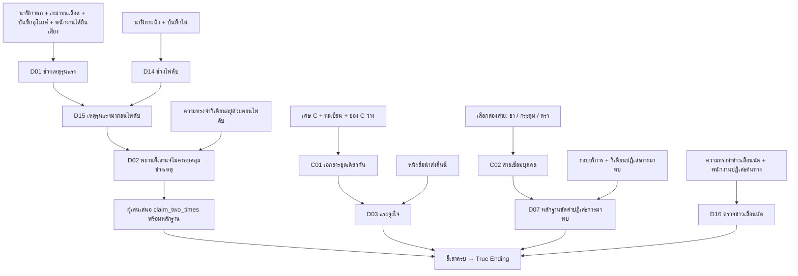

# Nocturne Express — ระยะ B: เรื่องที่เล่นได้และสัญญาของหลักฐาน

วันที่ 12 ตุลาคม 2026

เอกสารนี้อธิบายเนื้อหาและกติกาที่นำเข้าเกมแล้วใน `data/story.json` ไม่ใช่ข้อเสนอรออนุมัติ ใช้ [A2](phase-a-fact-sheet-v2-2026-10-09.md) เป็นฐานข้อเท็จจริง และ [เป้าหมายการออกแบบ](design-goals-and-evaluation-2026-10-09.md) เป็นเกณฑ์ความซับซ้อน เรื่องไม่มีผู้โดยสารคนที่แปด ตัวละครบนขบวนที่กล่าวหาได้มีเพียงกิเดียน ลิโอรา และวินเซนต์ ส่วนพนักงานกับผู้ป่วยเป็นพยาน

## 1. สิ่งที่ผู้เล่นต้องค่อย ๆ เข้าใจ

เรื่องเปิดด้วยความทรงจำจริงสองเรื่อง: กิเดียนบอกว่าพนักงานฝากข่าวเลื่อนนัด และกิเดียนอยู่กับผู้เล่นตอนไฟดับ การสืบสวนไม่ได้ลบความทรงจำเหล่านี้ แต่เปลี่ยนว่ามันยืนยันอะไรได้บ้าง ผู้เล่นต้องแยกเวลาเหตุรุนแรงออกจากเวลาพบศพ และตรวจต้นทางของข่าวที่ได้ยินผ่านบุคคลอื่น

คดีเก่าปี1923คือคำสั่งให้ขบวนเดินต่อทั้งที่มีคำเตือน และการตัดเอกสารกับคำให้การออกจากสำนวนหลังรถชน เอเลียสรอดชีวิตและเสียชีวิตด้วยโรคประจำตัวในปี1931 ลิโอราเก็บคำให้การเพื่อคืนความน่าเชื่อถือให้พ่อ แคสเซียนเคยลงนามปิดคดีและกำลังส่งหลักฐานใหม่ กิเดียนจึงต้องการหยุดการส่งสำนวนคืนนี้

วินเซนต์มีเป้าหมายแยกจากกิเดียน: มาราจ้างให้เอาสมุดต้นฉบับพ่อในแฟ้มBคืนก่อนถูกส่งลงเวสต์มาร์ช23:00 เขาเลือกตัดไฟเองและไม่รู้ข่าวเลื่อนนัด จึงไม่ต้องสมมติว่าโจรและฆาตกรรู้แผนกัน

| ช่วง | การกระทำที่ทำให้เข้าใจเพิ่ม | สิ่งที่ยังไม่ควรสรุป |
|---|---|---|
| บทนำ20:45–21:30 | รู้ข่าวเลื่อนนัดและมีความทรงจำว่ารอกับกิเดียน | พยานตอนไฟดับไม่ได้ครอบคลุมก่อนขึ้นรถ |
| ตรวจตู้4 | อ่านนาฬิกาสองชนิด เขม่ากับเลือด และร่องรอยในห้อง | นาฬิกาแตกไม่ใช่เครื่องบอกนาทีเสียชีวิต |
| คุยพนักงานตู้3 | เทียบเสียงกระแทกกับอุโมงค์ รอบบริการ และต้นทางข่าว | พนักงานไม่เห็นคนลงมือหรือหน้าแขก |
| เปิดสำนวน | เทียบเลขเอกสารที่ถูกเผากับทะเบียนและหนังสือนำส่ง | ตัวย่อG.H.หรือแรงจูงใจอย่างเดียวไม่พิสูจน์ฆาตกรรม |
| กลับไปตรวจของใช้ | เลือกสองสายจากชา กระดุม และตรา | การมาพบยังต้องประกอบกับเวลาและแรงจูงใจ |
| เสนอข้อสรุปและยื่นคดี | ผู้เล่นเลือกความสัมพันธ์สองเวลาและแนบหลักฐานเอง | การเก็บครบไม่ได้ถูกนับว่าเข้าใจโดยอัตโนมัติ |

ลำดับนี้เป็นเส้นทางการเรียนรู้ที่มุ่งหวัง ผู้เล่นยังเดินสำรวจและย้อนถามได้ตามข้อมูลที่มี

## 2. ไทม์ไลน์ที่เกมใช้

| เวลา | เหตุการณ์ | แหล่งที่ผู้เล่นตรวจได้ |
|---|---|---|
|20:10|พนักงานเห็นแคสเซียนมีชีวิตและได้คำสั่งให้พานรินทร์มาหากถามถึง|หัวข้อ `car_attendant:service`|
|ราว20:15|ส่งถ้วยน้ำร้อนเพิ่มให้แขกที่ไม่เห็นหน้า|รอบบริการและใบรับทราบใต้โต๊ะ|
|20:20–20:26|ผ่านอุโมงค์ มีเสียงกระแทกและของแตกในห้อง|บันทึกเดินรถ คำให้การพนักงาน นาฬิกาเสียหายและเขม่าบนเลือด|
|ราว20:25|ข้อเท็จจริงสำหรับผู้เขียน: กิเดียนทำร้ายแคสเซียนถึงตาย|ผู้เล่นประกอบช่วงเหตุจากหลายสาย ไม่ได้รับนาทีตายจากแพทย์|
|ก่อน20:45|กิเดียนเผาส่วนสำคัญของแฟ้มC อ่านกำหนดรับมอบ และออกจากห้อง|เศษเอกสาร ทะเบียน หนังสือนำส่ง และคำอ้างของเขา|
|20:45|นรินทร์และวินเซนต์ขึ้นฮัลเบิร์ด กิเดียนหลอกข่าวเลื่อนนัด|ความทรงจำบทนำ ตั๋วและคำให้การ|
|21:15–21:18|วินเซนต์ตัดสายหลัก เข้าห้องแล้วหนี; พนักงานเปิดไฟสำรอง|ระบบไฟ คีม และบทรับสารภาพหลังเผชิญหลักฐาน|
|ราว21:20|พนักงานเห็นประตูแง้ม พบศพ แล้วตามลิโอรา|คำให้การทั้งสองคน|
|21:30–23:00|ช่วงเล่น90นาทีจนส่งมอบคดีที่เวสต์มาร์ช|บทนำและนาฬิกาเกม|

ไฟส่องสว่างทำงานระหว่างลอดอุโมงค์ หน้าต่างที่แง้มทำให้เขม่าเข้าได้ ใบรับทราบตกใต้โต๊ะระหว่างต่อสู้จึงพ้นสายตากิเดียน เขาไม่ได้ทิ้งไว้เพราะห้องมืด มีดเปิดจดหมายอยู่ในห้องและระบุได้เพียงว่าเป็นอาวุธที่ต้องตรวจต่อ ไม่สร้างผลตรวจลายนิ้วมือขึ้นเอง

## 3. แผนผังเหตุผลที่ใช้จริง

`D01_TRUE_MURDER_WINDOW` เก็บ ID เดิมเพื่อรองรับโค้ด แต่ความหมายใหม่คือช่วงเหตุรุนแรงที่เชื่อมกับบาดแผล ไม่ใช่ผลแพทย์ระบุนาทีตาย `gideon_no_early_alibi` เก็บทั้งคำปฏิเสธการไปห้องและการไม่มีพยาน การไม่มีพยานเพียงส่วนเดียวไม่สร้างข้อสรุปเรื่องโอกาส

สี่เสาของกิเดียนคือเส้นเวลา (`D02` พร้อม `claim_two_times`), แรงจูงใจ (`D03`), หลักฐานการมาพบ (`D07`), และต้นทางข่าวเลื่อนนัด (`D16`) เงื่อนไข True Ending ใช้สี่เสาเดียวกันและต้องมีข้อสรุปที่ผู้เล่นเสนอ ไม่มีการบังคับเขม่าที่เสื้อเพื่อแทนสายส่วนตัวที่ผู้เล่นไม่ได้เลือก

## 4. ทางเลือกสองในสามและขนาดคดี

ทุกคู่ใช้หลักฐานฐาน15ชิ้นร่วมกัน: เส้นเวลา7ชิ้น, เอกสาร4ชิ้น, รอบบริการกับคำปฏิเสธการมาพบ2ชิ้น, ข่าวเลื่อนนัดกับคำปฏิเสธต้นทาง2ชิ้น รายการ ID ที่ใช้งานจริงอยู่ใน `data/walkthrough.json` ช่อง `winning_cases`

| สายส่วนตัว | หลักฐานของสายนั้น |
|---|---|
|ชา|`second_teacup`, `tea_lozenge_trace`, `gideon_lozenge_tin`|
|กระดุม|`obsidian_cufflink`, `gideon_missing_button`|
|ตรา|`wax_seal_imprint`, `gideon_signet_ring`|

| คู่ที่เลือก | หลักฐานยื่นขั้นต่ำตามกฎ | จำนวนที่ยังเหลือจากเพดาน20 |
|---|---:|---:|
|กระดุม + ตรา|19|1|
|ชา + กระดุม|20|0|
|ชา + ตรา|20|0|

เพดานนี้ปรับจาก15ให้รองรับทุกคู่ตามข้อกำหนดจริง ไม่ใช่ตัวเลขที่ยืนยันแล้วว่าภาระการเลือกเหมาะกับผู้เล่น การทดลองผู้เล่นต้องตรวจว่าการเลือก19–20รายการทำให้เหนื่อยหรือเข้าใจยากเพียงใดก่อนตรึงงานวิจัย

## 5. พยาน บทตามสถานะ และด่านล็อก

บทสนทนาใช้หัวข้อคงที่ จึงย้อนถามได้โดยไม่ให้ตัวละครสร้างข้อเท็จจริงเพิ่มเอง ID หัวข้อเป็นภาษาอังกฤษ ส่วนป้ายและข้อความแสดงเป็นภาษาไทย

| บุคคล | หัวข้อ | เงื่อนไข/ผลสำคัญ |
|---|---|---|
|กิเดียน|`account`, `message`, `past`|ปฏิเสธการมาพบ; ถามข่าวเลื่อนนัดหลังตรวจต้นทาง; ถามแฟ้มหลังเชื่อมแรงจูงใจ|
|ลิโอรา|`examination`, `father`|การตรวจศพมอบกุญแจแพทย์; เรื่องพ่อเปิดหลังอ่านแฟ้ม|
|วินเซนต์|`arrival`, `blackout`, `job`|การมาถึง; รับสารภาพเมื่อเทียบเครื่องมือ; ผู้จ้างเมื่ออ่านบันทึกงาน|
|พนักงาน|`service`, `impact`, `station`|รอบบริการ/ต้นทางข่าว; เสียงหลังตรวจนาฬิกา; ใบรับรองหลังตรวจตั๋ว|
|ผู้ป่วย|`care`|ยืนยันช่วงที่ลิโอราอยู่ด้วย เป็นพยานแยกจากสมุดรักษา|

หลักฐานจากคำให้การมอบเฉพาะเมื่อพูดหัวข้อนั้นแล้ว พนักงานและผู้ป่วยไม่มีสิทธิ์เป็นเป้ากล่าวหา

| ด่าน | วิธีเปิด | สิ่งที่เปิดให้ตรวจ | หน้าที่ |
|---|---|---|---|
|`dossier_bag`|รหัส1923จากบันทึกข้างกระเป๋า|แฟ้มที่ขาด ทะเบียน หนังสือนำส่ง|อ่านบริบทปีคดีก่อนเห็นแรงจูงใจ|
|`electrical_room_door`|หยิบ `staff_key` ที่ตู้3|อุปกรณ์ไฟและบันทึกเวลา|แยกไฟดับจากเหตุรุนแรงและตรวจความผิดวินเซนต์|
|`medical_room_door`|รับ `medical_key` จากหัวข้อ `examination`|แฟ้มเอเลียสและสมุดรักษา|ทำความเข้าใจลิโอราและตรวจที่อยู่ เป็นทางเสริมของคดีกิเดียน|

ล็อกปิดวัตถุภายใน ไม่ปิดการเดินทั้งตู้ การตรวจ (`examine`) ไม่ปลดล็อก การพิมพ์ชื่อหลักฐานภายในโดยตรงไม่ข้ามเงื่อนไข

## 6. การใช้ความเข้าใจในเกม

เมื่อพบนาฬิกาทั้งสองเรือน สมุดคดีเปิดคำถามสามทาง: เหตุรุนแรงมาก่อนไฟดับ, พบศพหลังไฟกลับจึงเกิดเหตุตอนไฟดับ, หรือผู้ตัดไฟต้องเป็นผู้ฆ่า ผู้เล่นเลือกและแนบหลักฐานเอง ไม่ได้ถูกตั้งค่าข้อสรุปถูกให้ล่วงหน้า

ข้อสรุปที่ผ่านคือ `claim_two_times` ต้องแนบข้อมูลจริงทั้ง7รายการของเส้นเวลา หากเลือกถูกแต่รองรับไม่ครบ ระบบยังไม่รับรอง ถ้าผ่านแล้วแต่ตัดหลักฐานจำเป็นออกจากชุดกล่าวหา เสาเส้นเวลาก็ไม่ผ่าน ส่วนหลักฐานเสริมที่เคยแนบ เช่นมีดเปิดจดหมาย ไม่จำเป็นต้องยื่นซ้ำหากส่วนที่เหลือยังรองรับข้อสรุปครบ การทบทวนข้อสรุปไม่ใช้จำนวนโอกาสกล่าวหา แต่เวลาเกมยังเดิน

ก่อนปิดคดี สมุดแสดงสิ่งที่พบ คำให้การ/แหล่งข่าว และคำถาม ไม่แสดงข้ออนุมานอัตโนมัติทั้งหมดหรือสี่เสาที่ชี้คำตอบไปก่อน เมื่อปิดคดีจึงใช้ชุดหลักฐานที่ยื่นจริงอธิบายผล การเลือกรายการในเมนูนี้ยังไม่เท่ากับผู้เล่นอธิบายได้เอง จึงมี [แบบตรวจความเข้าใจแยก](research-protocol-2026-10-12.md)

## 7. กรณีที่ต้องรักษาเมื่อพัฒนาต่อ

| กรณี | ผลที่ถูกตามข้อกำหนด |
|---|---|
|รู้ว่าใครตัดไฟ แต่ไม่มีหลักฐานสถานีก่อนขึ้นรถ|ยังไม่ถือว่าหักล้างโอกาสฆาตกรรมของวินเซนต์|
|มีตั๋วอย่างเดียว|ยังไม่สร้าง `D08_VINCENT_CLEARED`|
|มีตั๋ว ใบรับรองสถานี และช่วงเหตุรุนแรง|หักล้างวินเซนต์; ห้ามละหลักฐานที่รู้นี้เพื่อกล่าวหาเขา|
|มีสมุดรักษาลิโอราอย่างเดียว|ยังต้องมีพยานผู้ป่วยก่อนหักล้างที่อยู่|
|พบชาหรือแหวนเพียงสายเดียว|ยังไม่ครบสายเชื่อมบุคคล|
|เก็บหลักฐานครบแต่ยังไม่เสนอข้อสรุป|ยังไม่เข้า True Ending|
|ยื่นครบหนึ่งในสามคู่และข้อสรุปมีหลักฐานรองรับ|เข้า True Ending โดยไม่ต้องพบสายส่วนตัวที่สาม|
|อ้างชื่อหลักฐานที่ยังล็อกหรือคำให้การที่ยังไม่ได้ยิน|ปฏิเสธและไม่เพิ่มหลักฐาน|

การทดสอบระบบยืนยันเงื่อนไขเหล่านี้ได้ ส่วนความสนุก จังหวะเฉลย และความเข้าใจต้องตรวจจากผู้เล่นจริง ผลการตรวจรอบส่งมอบอยู่ใน [รายงานการนำเข้าเกม](implementation-report-2026-10-12.md)
